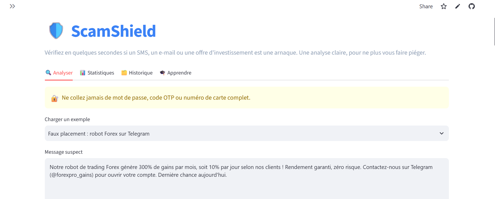

# 🛡️ ScamShield

**ScamShield** est un détecteur d'arnaques financières. Vous collez un message suspect (SMS, WhatsApp, e-mail, annonce, publication sur les réseaux sociaux) ou le texte d'une offre d'investissement, et l'application vous indique :

- un **score de risque** sur 100 ;
- un **niveau** : Sûr (0-30), Suspect (31-65) ou Arnaque probable (66-100) ;
- le **type d'arnaque** détecté ;
- les **signaux suspects**, expliqués simplement ;
- des **conseils d'action** concrets.

L'analyse combine un **moteur de règles** (mots-clés, liens, marques marocaines imitées, etc.) et une **IA** (modèle `llama-3.3-70b-versatile` via l'API Groq). Sans clé API, l'application fonctionne uniquement avec le moteur de règles.

Types d'arnaques couverts : phishing bancaire, faux placements (Forex, crypto, rendement garanti), pyramides de Ponzi et marketing de réseau abusif, faux prêts avec frais à payer d'avance, faux gains (loterie, héritage), et autres arnaques.

## Captures d'écran


## Installation

Prérequis : Python 3.10 ou plus récent.

```bash
cd scamshield
pip install -r requirements.txt
```

## Configuration de la clé Groq

1. Créez une clé gratuite sur la console Groq.
2. Copiez le fichier d'exemple :
   ```bash
   copy .streamlit\secrets.toml.example .streamlit\secrets.toml
   ```
   (Sous macOS ou Linux : `cp .streamlit/secrets.toml.example .streamlit/secrets.toml`.)
3. Ouvrez `.streamlit/secrets.toml` et remplacez la valeur par votre clé :
   ```toml
   GROQ_API_KEY = "gsk_votre_cle"
   ```

La clé n'est jamais écrite dans le code. Le fichier `.streamlit/secrets.toml` est exclu de Git par `.gitignore`.

Si la clé est absente ou si l'API ne répond pas, l'application continue avec le moteur de règles et affiche un message d'information.

## Lancement

```bash
python -m streamlit run app.py
```

L'application s'ouvre dans le navigateur à l'adresse indiquée dans le terminal (par défaut `http://localhost:8501`).

## Déploiement sur Streamlit Community Cloud

1. Poussez le projet sur GitHub, **sans** le fichier `.streamlit/secrets.toml` ni la base `scamshield.db`.
2. Sur [share.streamlit.io](https://share.streamlit.io), créez une application à partir de votre dépôt, avec `app.py` comme fichier principal.
3. Ouvrez les paramètres de l'application, puis la rubrique **Secrets**, et ajoutez :
   ```toml
   GROQ_API_KEY = "gsk_votre_cle"
   ```
4. La clé se saisit uniquement dans « Secrets », **jamais dans GitHub**.

## Structure du projet

```
scamshield/
├── app.py                    # Point d'entrée : navigation par onglets et mise en page
├── analyzer.py               # Score final : fusion des règles et de l'IA
├── rules.py                  # Moteur de règles, catalogue des types, fiches pédagogiques
├── ai_engine.py              # Appel à Groq et lecture sécurisée du JSON
├── database.py               # Historique SQLite
├── charts.py                 # Graphiques Plotly
├── styles.py                 # CSS personnalisé et composants HTML
├── samples.py                # Exemples de messages pour tester l'application
├── requirements.txt
├── .gitignore
├── .streamlit/
│   ├── config.toml           # Thème sombre
│   └── secrets.toml.example  # Modèle de configuration de la clé (sans vraie clé)
└── README.md
```

## Limites de l'outil

- **Une estimation, pas une preuve.** Le score est indicatif. Une arnaque bien construite peut passer inaperçue, et un message légitime peut parfois être signalé à tort.
- **Détection par règles.** Le moteur repère des mots, des formes et des domaines suspects. Il ne vérifie ni l'identité de l'expéditeur, ni l'existence réelle d'un site, ni la validité d'un numéro.
- **Marques marocaines.** Un domaine contenant le nom d'une banque mais ne finissant pas par `.ma` est signalé pour vérification. Certains sites officiels peuvent donc être signalés à tort.
- **IA.** Le modèle peut se tromper. Le texte envoyé est tronqué à 3 000 caractères. Si l'IA n'est pas disponible, seules les règles sont utilisées.
- **Confidentialité.** Le message complet n'est pas stocké : seul un extrait de 200 caractères est conservé dans la base locale `scamshield.db`. Si l'IA est activée, le texte est envoyé à l'API Groq.
- **Langues.** La détection de la darija et de l'arabe repose sur des listes de mots. Elle reste imparfaite pour les formulations très libres ou les fautes d'orthographe.
- **Pas de conseil juridique.** En cas d'arnaque avérée, adressez-vous à votre banque et aux autorités compétentes.

⚠️ Ne collez jamais de mot de passe, de code OTP ou de numéro de carte complet dans l'application.

## Ma contribution personnelle

> À compléter : décrivez ici ce que vous avez ajouté ou modifié par rapport au projet de base (nouvelles règles, nouveaux exemples, amélioration de l'interface, tests réalisés, difficultés rencontrées et solutions apportées, etc.).

- Contribution 1 : …
- Contribution 2 : …
- Ce que j'ai appris : …
